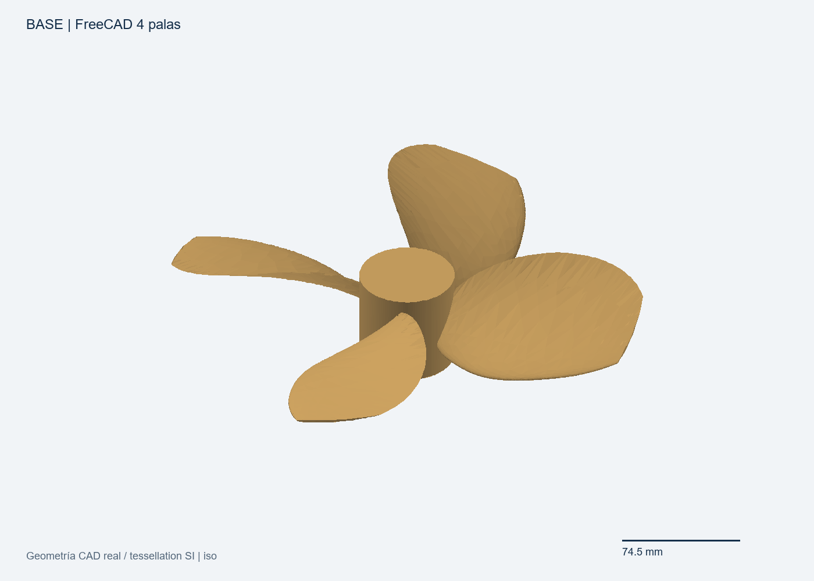
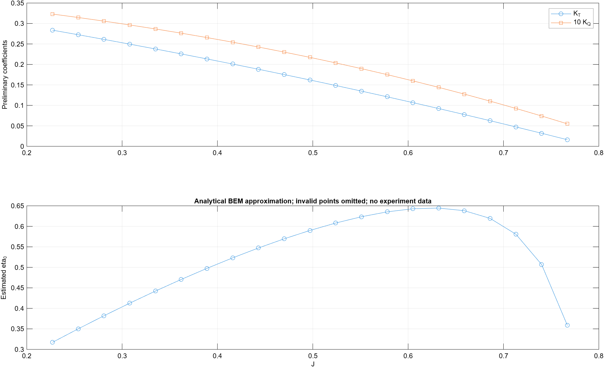
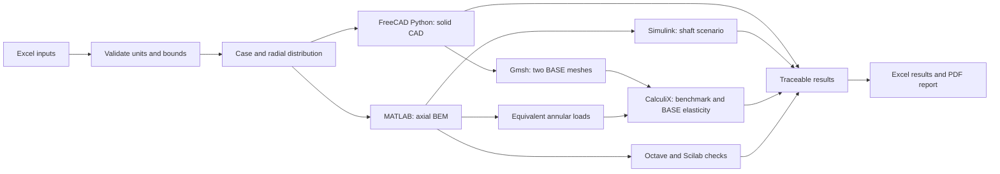
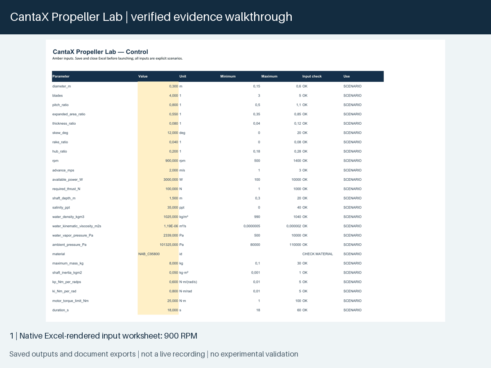
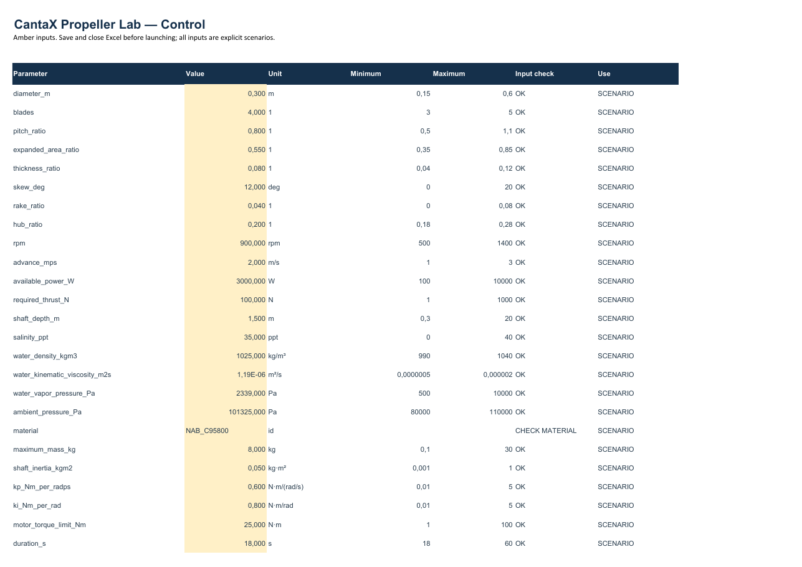
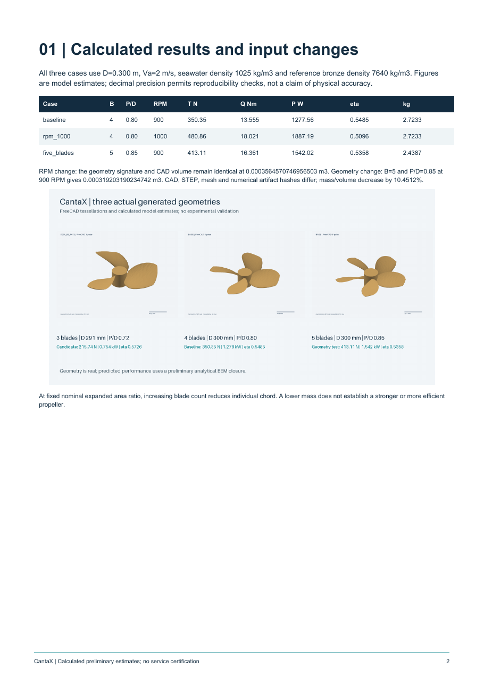
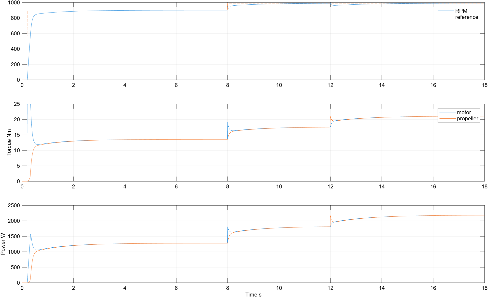

# CantaX Propeller Lab — Parametric Marine Propeller Engineering



**A reproducible Windows engineering workflow that connects spreadsheet inputs, parametric CAD, preliminary propeller calculations and technical reports.**

CantaX turns a change in diameter, blade count, pitch or operating speed into a new, traceable set of engineering files. It combines software developed for this project with established desktop engineering applications. Its purpose is to make early design studies easier to reproduce, compare and inspect.

Version 1.0 is a working research demonstrator. The reported figures are calculated estimates, not measurements. It is not certified naval software, validated 3D CFD, or a finished commercial product.

## What has actually run

Four historical full workflows were executed on Windows. Each created 13 CAD geometries; the baseline case in each workflow also received two tetrahedral meshes and a preliminary elastic calculation. All 52 solids passed geometry checks and FCStd/STEP save-and-reopen checks. The four result workbooks were opened and recalculated through Excel, and the four original 11-page reports were rendered and inspected.

A separate release regression executed the public source through the complete native pipeline: Excel input → 13 FreeCAD solids → MATLAB/Simulink → Gmsh/CalculiX → Octave/Scilab → native Excel verification → PDF. The public openpyxl workbook backend was natively recalculated with zero formula errors. The generated 11-page run report and the [eight-page public report](docs/cantax-technical-report.pdf) passed visual review. See the [release execution record](examples/PUBLIC_RELEASE_VERIFICATION.json) and [published PDF QA](docs/PUBLICATION_QA.json).

The release contains selected, sanitized outputs from those runs. Public examples use seawater density 1,025 kg/m³ and advance speed 2 m/s as explicit scenario inputs.

| Case | Diameter | Blades | P/D | RPM | Thrust | Torque | Shaft power | Open-water efficiency | CAD mass |
|---|---:|---:|---:|---:|---:|---:|---:|---:|---:|
| Baseline | 0.300 m | 4 | 0.80 | 900 | 350.35 N | 13.56 N·m | 1.278 kW | 0.5485 | 2.723 kg |
| Speed change | 0.300 m | 4 | 0.80 | 1,000 | 480.86 N | 18.02 N·m | 1.887 kW | 0.5096 | 2.723 kg |
| Geometry change | 0.300 m | 5 | 0.85 | 900 | 413.11 N | 16.36 N·m | 1.542 kW | 0.5358 | 2.439 kg |

Increasing RPM preserved the CAD volume exactly. Changing the blade count and pitch regenerated the CAD, mesh and calculations; volume and mass decreased by 10.451% at the same nominal expanded area ratio. A lower mass does not establish better strength.

The final study compared **13 configurations**: one baseline plus 12 combinations varying diameter, blade count and pitch. The first candidate under the declared thrust, power, mass and CAD screening rules was `D291_B3_P072`: 215.74 N, 753.54 W and efficiency 0.5726. Its elastic analysis is **not calculated**; this is a ranking within a small sample, not a global or certified design optimum.



## How the automation works



The orchestrator creates a fresh directory for every calculation, records inputs and source hashes, and checks structured outputs rather than accepting an executable's exit code alone. The original Excel controller detects edited inputs. Updating a locked or concurrently modified controller is deferred so that calculated outputs and user edits can be preserved.

CAD images in this repository are renders of the actual generated geometry. They are not FreeCAD interface screenshots. The animation is a walkthrough of saved results, not a recording of a newly executed analysis.



For a real Excel-to-launcher recording, use the [demonstration storyboard](presentation/demo-storyboard.md). It identifies the required native application captures and any shortened calculation wait.

## Excel controls and generated report



Edit the amber cells, save the workbook and start the launcher. The inputs are validated for units and bounds; a new run preserves its own input copy. These captures were exported by Excel itself. The author's Excel locale uses a decimal comma; stored numerical values are locale independent.



The report presents calculated results, real CAD geometry, methodology, verification and unresolved physical limitations. [Open the eight-page PDF](docs/cantax-technical-report.pdf). Selected editable [baseline CAD](examples/verified_runs/baseline/cad/) and [five-blade CAD](examples/verified_runs/five_blades/cad/) examples include FCStd and STEP files; the source regenerates the full families.

## Run a demonstration

The saved-results demonstration does not need Excel, MATLAB, an AI account or an API key. After installing the Python requirements in your own environment:

```powershell
python scripts/run_lab.py --demo
```

This checks the included example data and prints the parameter-change comparisons; it does not perform new simulations. See [installation and execution](docs/INSTALLATION.md) for the complete setup and for configuring installed application paths before a new calculation.

Start with the [baseline example](examples/verified_runs/baseline/), compare [1,000 RPM](examples/verified_runs/rpm_1000/) and [five blades](examples/verified_runs/five_blades/), and then inspect the [diameter study](examples/verified_runs/diameter_study/).

The [public technical report](docs/cantax-technical-report.pdf) explains the numerical results and the model's scope. Reproducing an original full run requires separately installed engineering software and applicable licenses; those applications and their installers are not distributed here. Once configured, `python scripts/run_lab.py --create-input` creates a controller and `python scripts/run_lab.py --run` starts the actual workflow. `Start_CantaX.bat` provides the Windows entry point.

## Applications and integration status

These are the versions observed in the original verified installation, not a promise that every later or earlier version is compatible.

| Tool | Observed version | Integration used and verified |
|---|---|---|
| FreeCAD | 1.1.4 | Embedded Python, solids, FCStd/STEP round trips |
| Microsoft Excel | 16.0.20430.20146 | COM input reading, recalculation, workbook verification and controller handling |
| MATLAB | R2026a Update 2 | Batch BEM, curves and sensitivity calculations |
| Simulink | R2026a | Real SLX creation, execution, save/reopen/resimulation |
| GNU Octave | 11.3.0 | Independent coefficient and unit checks |
| Scilab | 2026.1.0 | Independent coefficient and unit checks |
| Gmsh | 4.15.0 | STEP import, two tetrahedral BASE meshes and mesh checks |
| CalculiX | 2.22 | Analytical benchmark and preliminary BASE elasticity |

Xcos passed an earlier integration smoke test, but is not a second propeller dynamics solver in this workflow. MATLAB Engine was tested in the original environment; this laboratory uses MATLAB batch execution. **Inventor COM, ParaView/pvpython and DWSIM API/MCP are not operational integrations demonstrated by this release.** No global MCP server is required or advertised.

## Technical scope

- **Geometry:** three-, four- and five-blade solids from radial chord, pitch, thickness, skew and rake inputs; a closed symmetric thickness section, lofted blades, hub fusion and a cylindrical tip trim.
- **Hydrodynamics:** positive-thrust axial blade element momentum model, analytic thin-airfoil lift, approximate friction drag and Prandtl loss factors. Annular residuals, domain guards, radial refinement and hypothesis sensitivity are recorded.
- **Dynamics:** shaft inertia, PI speed control, torque saturation and a load lookup in an actual Simulink model. Startup below the admitted BEM branch uses an explicitly declared scenario extrapolation.
- **Structures:** conservative annular resultant transfer, centrifugal loads, a rigid-hub boundary assumption and linear C3D4 tetrahedra. Only each run's BASE has an elastic estimate.
- **Verification:** geometry round trips, coefficient/unit checks, mesh checks, a CalculiX analytical benchmark, dynamic balances and repeatability, and spreadsheet consistency.

The 1,000 RPM case discovers a motor limit: the final speed/load scenario needs **27.60 N·m** against a **25 N·m** cap. The numerical integration passes while the requested operating condition is capacity-limited. Results are not forced to meet the target.



## Limits before engineering use

There are no measured section polars or open-water test data for this geometry. The BEM drag closure omits pressure drag and validated transition/separation behavior. Skew, rake and CAD tip trimming do not receive resolved 3D hydrodynamic treatment. Cavitation, ventilation, vessel wake, fatigue, corrosion and classification requirements are not established.

The baseline elastic figures—approximately 35.42 µm maximum displacement and 16.93 MPa integration-point von Mises stress—are preliminary. Two mesh sizes do not establish stress convergence. Manufacturing details, real hub supports and material allowables are absent; no factor of safety or service life is claimed.

Numerical verification establishes consistency of the declared models. It does not establish physical accuracy or authorize manufacture or vessel operation.

## Documentation

| Document | Contents |
|---|---|
| [Installation](docs/INSTALLATION.md) | Saved demonstration, tool paths, full execution and dependencies |
| [Architecture](docs/ARCHITECTURE.md) | Data flow, file contracts, units and runtime responsibilities |
| [BEM model](docs/BEM.md) | Equations, closures, guards, sensitivity and physical limits |
| [Structural analysis](docs/STRUCTURAL_ANALYSIS.md) | Material data, loads, benchmark, mesh checks and elastic scope |
| [Verification](docs/VERIFICATION.md) | Executed cases, acceptance criteria and reproducibility boundaries |
| [Roadmap](docs/ROADMAP.md) | Validation, structural convergence and packaging work still needed |
| [LinkedIn draft, Spanish](presentation/linkedin-es.md) | Proposed message for author review; not posted |
| [LinkedIn draft, English](presentation/linkedin-en.md) | English version for author review; not posted |
| [Demonstration storyboard](presentation/demo-storyboard.md) | A 30–60 second recording plan using real inputs and outputs |

## Development, rights and attribution

The implementation was developed with AI assistance. Numerical checks and presentation inspections are recorded; they are not independent human validation of the physical models. The author is responsible for reviewing the release and professional communication before presenting it as human-approved work.

Project-authored material is governed by [LICENSE](LICENSE). See [THIRD_PARTY_NOTICES.md](docs/THIRD_PARTY_NOTICES.md) for dependency and source attribution. Third-party applications retain their own licenses; this repository does not grant rights to install, copy or redistribute them. Public reference documents are linked, not bundled.

The public distribution is prepared separately from the working engineering project and contains selected examples, source and documentation. Proprietary installers, application binaries, private logs, credentials and unrelated project data are excluded.
